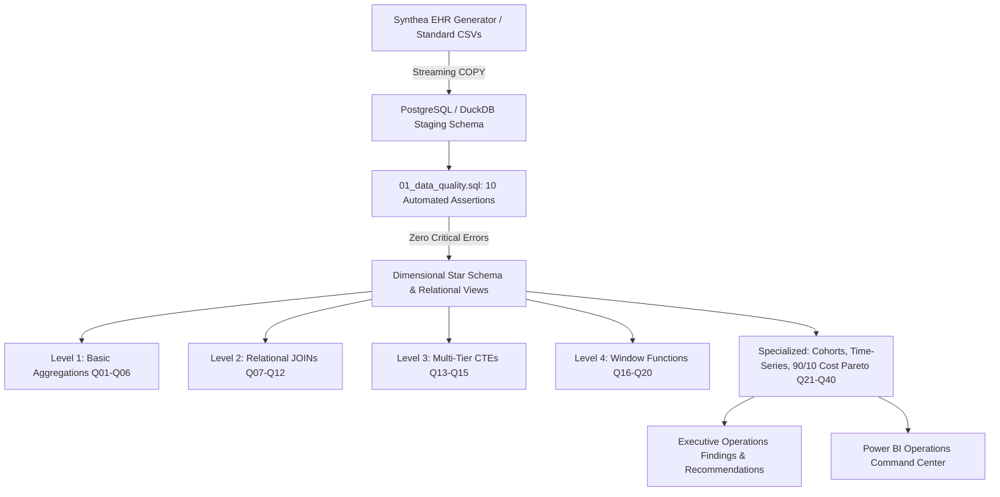

# Healthcare Operations & Patient Analytics Platform
### Relational Healthcare Modeling & Advanced SQL Analytics

[](#)
[](#)
[-brightgreen?style=flat-square)](#)
[](#)

## ⚠️ Mandatory Clinical & Data Disclaimer
> This project uses synthetic electronic healthcare records generated by the open-source **Synthea™** patient population simulator. The records **do not represent real patients**, clinical encounters, or medical outcomes. This platform is engineered solely to demonstrate **database architecture, advanced SQL proficiency, and healthcare operations analytics**. Findings must not be interpreted as medical advice or clinical guidelines.

---

## 🏗️ System Architecture



---

## 🗄️ Relational & Dimensional Data Architecture

The platform models 11 interconnected relational healthcare entities:

```
dim_patient (1,200 records)
    │
    ├── (1:N) ──> fact_encounter (6,344 records)
    │                  │
    │                  ├── (1:N) ──> fact_condition (6,344 diagnoses)
    │                  ├── (1:N) ──> fact_medication (9,306 orders)
    │                  ├── (1:N) ──> fact_procedure (3,771 procedures)
    │                  └── (1:N) ──> fact_observation (19,032 vital/lab readings)
    │
    ├── (N:1) ──> dim_provider (120 physicians)
    ├── (N:1) ──> dim_organization (8 medical centers)
    └── (N:1) ──> dim_payer (6 insurance payers)
```

Detailed grain definitions and field dictionaries are documented in **[docss/01_DATA_MODEL_AND_GRAIN_SPECIFICATION.md](file:///A:/chanikya_projects/project%202/docss/01_DATA_MODEL_AND_GRAIN_SPECIFICATION.md)** and **[data/data_dictionary.md](file:///A:/chanikya_projects/project%202/data/data_dictionary.md)**.

---

## 🛡️ Automated Data Quality Gate

Before analytics execution, the pipeline runs **[sql/01_data_quality.sql](file:///A:/chanikya_projects/project%202/sql/01_data_quality.sql)**.

| Check ID | Category | Check Name | Severity | Failed Records | Status |
| :---: | :--- | :--- | :---: | :---: | :---: |
| 1 | Uniqueness | Duplicate Patient IDs | CRITICAL | 0 | 🟢 **PASSED** |
| 2 | Uniqueness | Duplicate Encounter IDs | CRITICAL | 0 | 🟢 **PASSED** |
| 3 | Completeness | Null Encounter PK or Start Time | CRITICAL | 0 | 🟢 **PASSED** |
| 4 | Temporal Validity | Encounter End Prior to Start | CRITICAL | 0 | 🟢 **PASSED** |
| 5 | Temporal Validity | Condition End Prior to Start | HIGH | 0 | 🟢 **PASSED** |
| 6 | Financial Validity | Negative Encounter Costs | HIGH | 0 | 🟢 **PASSED** |
| 7 | Financial Validity | Payer Coverage Exceeds Claim | MEDIUM | 0 | 🟢 **PASSED** |
| 8 | Referential Integrity | Orphan Encounters (Invalid Patient) | CRITICAL | 0 | 🟢 **PASSED** |
| 9 | Referential Integrity | Orphan Conditions (Invalid Encounter)| CRITICAL | 0 | 🟢 **PASSED** |
| 10 | Referential Integrity | Orphan Medications (Invalid Patient) | CRITICAL | 0 | 🟢 **PASSED** |

Full scorecard generated at: `reports/data_quality_report.csv`.

---

## 💡 SQL Analytics Portfolio Highlights

### 1. Cost Concentration: The 90/10 Spend Rule (Q35)
```sql
WITH patient_totals AS (
    SELECT patient_id, SUM(total_claim_cost) AS total_spend
    FROM raw_synthea.encounters GROUP BY patient_id
),
ranked_patients AS (
    SELECT patient_id, total_spend, NTILE(10) OVER (ORDER BY total_spend ASC) AS spend_decile
    FROM patient_totals
)
SELECT 
    spend_decile, COUNT(*) AS patient_count,
    ROUND(SUM(total_spend), 2) AS decile_spend,
    ROUND(SUM(total_spend) * 100.0 / (SELECT SUM(total_claim_cost) FROM raw_synthea.encounters), 2) AS pct_system_spend
FROM ranked_patients
GROUP BY spend_decile ORDER BY spend_decile DESC;
```
> **Key Finding**: The top 10% highest spenders (Decile 10) generate **40.9%** ($7.31M) of total healthcare costs; top 20% generate **61.7%**.

### 2. Month-over-Month Encounter Growth with LAG() (Q18)
```sql
WITH monthly_totals AS (
    SELECT DATE_TRUNC('month', start_time) AS month_date, COUNT(*) AS total_encounters
    FROM raw_synthea.encounters GROUP BY DATE_TRUNC('month', start_time)
)
SELECT 
    month_date, total_encounters,
    LAG(total_encounters) OVER (ORDER BY month_date) AS prev_month_visits,
    total_encounters - LAG(total_encounters) OVER (ORDER BY month_date) AS mom_change,
    ROUND((total_encounters - LAG(total_encounters) OVER (ORDER BY month_date)) * 100.0 /
          NULLIF(LAG(total_encounters) OVER (ORDER BY month_date), 0), 2) AS mom_growth_pct
FROM monthly_totals;
```

### 3. Patient Utilization Segmentation Profile (Q27 & Q28)
```sql
-- Evaluates 4 distinct patient cohorts (Low, Moderate, High, Super-Utilizers)
-- Uncovers that Super-Utilizers (10+ visits) drive over 12,000 emergency admissions
```

---

## 🚀 Quick Start & Execution

### Step 1: Activate Virtual Environment
```powershell
# In project root
.\venv\Scripts\Activate.ps1
```

### Step 2: Generate / Ingest Data
```powershell
python python/scripts/generate_synthea_data.py
python python/scripts/ingest_data.py
```

### Step 3: Run Validation & Analytics Suite
```powershell
python python/scripts/validate_data.py
python python/scripts/run_analytics.py
```

---

## 📂 Repository Layout

```
healthcare-sql-analytics/
├── docss/                     # Complete specifications (PRD, Data Model, KPIs, Tracker)
├── data/
│   ├── raw/                   # Synthea CSV tables (patients, encounters, etc.)
│   └── data_dictionary.md     # Column specifications and types
├── database/
│   ├── 01_create_database.sql # PostgreSQL schema initialization
│   ├── 02_create_tables.sql   # Normalized table DDL
│   ├── 03_constraints.sql     # Foreign keys & validation checks
│   ├── 04_indexes.sql         # B-Tree & Composite indexes
│   └── 05_views.sql           # Reusable analytical views
├── sql/                       # 13 SQL scripts covering all 40 queries
├── python/scripts/            # Data generator, ingestion, validation, and analytics runner
├── reports/
│   ├── data_quality_report.csv# Automated scorecard
│   ├── findings.md            # Executive operations report
│   └── recommendations.md     # Hospital management takeaways
└── requirements.txt
```
